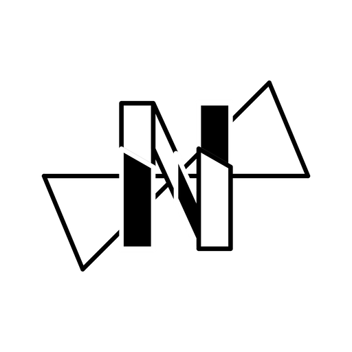

<p align="center">
  
</p>

# Nevelim

A cross-platform hotkey-driven snippet launcher with AI-powered template adaptation.
Press a global hotkey (default `alt+shift+v`) and a radial overlay appears right at your
cursor: pick a snippet, pick an action — copy, paste, edit, or adapt it to your project's
specification with an AI provider of your choice (Gemini, OpenAI, OpenRouter).

Built with **Tauri v2** (Rust + TypeScript). No Electron, no heavy UI frameworks —
just a tiny webview, native-speed backend logic and GPU-rendered UI.

## Features

- Global hotkey summons a lightweight overlay right at the mouse cursor
- Snippet library from plain `templates/*.md` / `*.txt` files
- Radial navigation: hub → snippets → actions, fully keyboard-driven
  (arrows dive in and out on the matching side of the hub, `Enter` runs,
  `1–4` are shortcuts, `Esc` closes)
- Actions: copy, paste into the previously focused window (auto-paste is
  configurable), open in editor, AI-adapt
- AI adaptation against a project specification (`docs/SPECIFICATION.md`,
  `spec.md`, …) with an interactive refinement chat
- Settings window: hotkey recorder (click and press a combination), provider
  switch with an availability check, export folder picker, auto-paste toggle
- Backup export: config + templates packed into a timestamped `.zip` in the
  export folder (the folder opens automatically); the import wizard restores
  such archives (without overwriting existing templates)
- Local-first: templates, history and config live on your machine

## Repository layout

```
src/frontend/   TypeScript + Vite web layer (overlay, modal, settings, import UI)
src/backend/    nevelim-core: pure Rust business logic (no Tauri dependency)
src/desktop/    nevelim-desktop: Tauri shell (windows, hotkeys, plugins, IPC)
tests/          Frontend (Vitest) and end-to-end smoke tests
docs/           Technical documentation & specifications
config.example.json    Template for the local config.json (API keys live there)
```

## User data

All data lives next to the executable (or in the project root during development):

| Path               | Purpose                                            |
| ------------------ | -------------------------------------------------- |
| `config.json`      | Settings: hotkey, provider, API keys, export dir   |
| `templates/`       | Your snippets (`.md` / `.txt`)                     |
| `history/`         | Adaptation results per snippet                     |

## Development

Prerequisites: [Rust](https://rustup.rs) 1.78+, Node.js 20+, and the
[Tauri v2 prerequisites](https://v2.tauri.app/start/prerequisites/) for your OS.

```bash
cd src/frontend
npm install
npm run app:dev      # starts the Vite dev server + the desktop app
```

Useful frontend scripts (run inside `src/frontend`):

```bash
npm run typecheck    # tsc --noEmit
npm run lint         # eslint
npm test             # vitest (unit tests live in tests/frontend/)
npm run test:coverage
npm run app:build    # production desktop bundle
```

Rust checks (run in the repository root):

```bash
cargo fmt --all -- --check
cargo clippy --workspace -- -D warnings
cargo test --workspace
```

See [CONTRIBUTING.md](CONTRIBUTING.md) for the development workflow and
[SECURITY.md](SECURITY.md) for reporting vulnerabilities.

## License

Licensed under the [Apache License 2.0](LICENSE).
